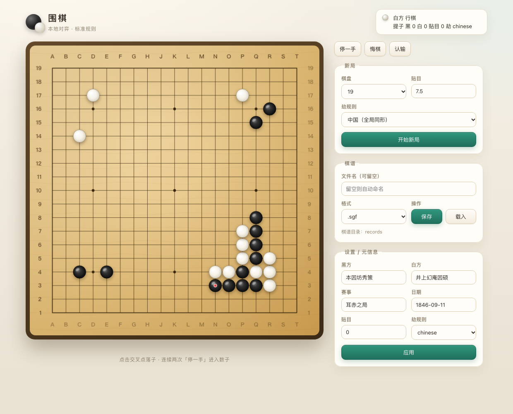

# python-weiqi

纯 Python、零依赖的本地围棋：**规则内核 + 命令行对弈 + 浏览器图形界面 + 棋谱（SGF / 文本）**。

支持两人交替落子、提子、禁入点、可选劫规则、悔棋、认输、标记死子与终局数子；
可把对局保存为标准 SGF 或文本棋谱，并加载已有 SGF 逐步回放。核心全部使用 Python 标准库，
无需安装任何第三方依赖；KataGo AI 是**可选**的外部引擎（见下文）。



> 截图开局：1846 年「耳赤之局」本因坊秀策（黑）对 井上幻庵因硕（白）前 25 手（大斜定式）。
> 历史棋谱属公有领域，见 [`docs/ear-reddening-opening.sgf`](docs/ear-reddening-opening.sgf)；
> 来源：[Wikipedia: Ear-reddening game](https://en.wikipedia.org/wiki/Ear-reddening_game)。

## 环境要求

- Python 3.9+（开发与测试于 3.14）。
- 使用 `python3` 命令（部分系统没有 `python` 别名）。
- 零第三方依赖：无需虚拟环境，无需 `pip install`。
- 命令行界面不需要图形库；浏览器界面只需任意现代浏览器。
- AI 对弈/落子为可选功能，需要另外安装 KataGo 和模型；未安装时其余功能不受影响。

## 目录结构

```
python-weiqi/
├── main.py                入口脚本
├── README.md              本文件：使用说明
├── PROJECT_LOG.md         项目日志（设计决策与开发记录）
├── LICENSE                MIT 许可证
├── .gitignore
├── ai.example.json        可选 AI 配置示例（复制为 ai.json 使用）
├── docs/
│   ├── screenshot-ear-reddening.png  界面截图
│   └── ear-reddening-opening.sgf     截图所用开局（公有领域）
├── records/               默认棋谱目录（运行时生成，不纳入版本库）
├── goban/                 核心包
│   ├── __init__.py        对外导出
│   ├── __main__.py        支持 python3 -m goban
│   ├── board.py           规则内核：棋盘、气、提子、禁入点、可选劫规则、数子
│   ├── game.py            对局管理：落子记录、悔棋、认输、终局结果
│   ├── player.py          玩家接口：Player / HumanPlayer，为 AI 预留
│   ├── sgf.py             SGF 解析/序列化与坐标转换
│   ├── record.py          棋谱模型 GameRecord：与 Game 互转、存取、回放步
│   ├── web.py             浏览器图形界面（内置 HTTP 服务 + 单页前端）
│   ├── cli.py             命令行界面：对弈、保存/加载、打谱回放
│   └── ai/                可选 AI：KataGo GTP 客户端（核心仍零依赖）
│       ├── base.py        引擎协议、局面快照、EnginePlayer
│       ├── config.py      ai.json / 环境变量 / Homebrew 自动发现
│       ├── katago.py      KataGo 子进程、GTP 协议、超时与重连
│       └── analysis.py    实时分析：JSON 流、胜率/目差/候选点/领地
├── tests/
│   ├── test_board.py      内核单元测试（14 个用例）
│   ├── test_sgf.py        SGF/棋谱与保存格式单元测试（32 个用例）
│   ├── test_counting.py   死子标记与数子测试（8 个用例）
│   ├── test_settings.py   设置模式测试（11 个用例）
│   ├── test_ko.py         劫规则测试（11 个用例）
│   ├── test_help.py       帮助系统测试（14 个用例）
│   ├── test_web.py        图形界面 API 与页面测试（12 个用例）
│   ├── test_ai.py         AI 配置与 GTP 协议测试（11 个用例）
│   ├── test_web_ai.py     网页 AI 接口测试（9 个用例）
│   └── test_analysis.py   实时分析解析/服务/HTTP 测试（9 个用例）
└── scripts/
    └── run_web.command    macOS 双击启动网页版
```

## 快速开始

先克隆并进入仓库根目录，所有命令都在这里执行：

```bash
git clone https://github.com/algebraicrain-coder/python-weiqi.git
cd python-weiqi
```

### 1. 运行自检测试

```bash
python3 -m unittest discover -s tests -v
```

期望输出结尾为：

```
Ran 131 tests in 4.2s

OK
```

### 2. 启动对弈

```bash
python3 main.py                # 默认 19 路，贴目 7.5
python3 main.py --size 9       # 9 路（便于快速试玩）
python3 main.py --size 13 --komi 6.5

# 选择劫规则（默认中国规则/位置超级劫）
python3 main.py --ko simple        # 简单劫；另可选 situational / japanese

# 带上棋手信息，保存的 SGF 会写入 PB/PW/EV/RU/DT 等元数据
python3 main.py --black Alice --white Bob --event 线上对局

# 直接载入一份棋谱继续下
python3 main.py --load game.sgf

# 浏览器图形界面
python3 main.py web                # 默认 127.0.0.1:8080 并自动打开浏览器
python3 main.py web --port 9000 --no-open

# macOS 双击启动（见下文）
# 打开 ~/Applications/围棋（网页版）.command

# 可选 AI（需先安装 KataGo，见下文）
python3 main.py --ai                       # AI 执白
python3 main.py --ai --ai-color black      # AI 执黑
python3 main.py --ai --ai-visits 200       # 控制强度/速度
```

### 3. 图形界面（浏览器）

```bash
python3 main.py web
```

启动本地 HTTP 服务（**纯标准库，无第三方依赖**）并在浏览器打开棋盘界面：

- **点击棋盘落子**；显示棋盘、星位、最后一手红点、提子数与轮次。
- **视觉**：木纹棋盘 + 四边坐标（字母 A–T 跳过 I、行号自下而上）、立体黑/白棋子与投影、
  悬停预落子虚影；高 DPI 清晰渲染，窄屏自动改为单列。
- 按钮：停一手、悔棋、认输、**标记死子**（终局两次 pass 后出现，点击切换死/活，
  死子半透明并打叉）、**完成数子**。
- **新局**：选棋盘大小、贴目、劫规则。
- **棋谱**：输入文件名保存/载入（默认棋谱目录 `records/`），保存可选格式后缀
  （`.sgf` / `.txt`，见下）。
- **设置/元信息**：黑方/白方/赛事/日期、贴目、劫规则，保存时写入 SGF。
- 选项：`--host`、`--port`、`--record-dir`、`--no-open`、`--no-ai` 及 `--ai-*`。
- 界面为内置单页 HTML/JS（Canvas 绘制），通过 JSON API 与同一套规则内核交互，
  与命令行共用 `Board`/`Game`/`GameRecord`。

等价的另一种启动方式：

```bash
python3 -m goban --size 9
```

### macOS 双击启动（网页版）

打开 Finder 里的：

```text
~/Applications/围棋（网页版）.command
```

双击即可启动本地服务并打开浏览器（默认 `http://127.0.0.1:8080/`）。
它只是调用仓库里的 [`scripts/run_web.command`](scripts/run_web.command)：

- 默认端口 **8080**；可用 `WEIQI_WEB_PORT=8090` 换端口；
- `WEIQI_NO_OPEN=1` 只启动服务、不自动开浏览器；
- 端口被占用时会提示，不会误开别的服务；
- 按 `Ctrl+C` 或关闭终端窗口会停止服务并释放端口。

如果仓库移动了位置，改一下 `~/Applications/围棋（网页版）.command` 里的
`TARGET` 路径即可。

## 可选 AI：KataGo

核心仍然是零依赖的本地围棋；AI 是**可选外部引擎**。检测到 KataGo 时：

- 命令行：`--ai` 让 AI 执白（默认），`--ai-color black` 让 AI 执黑；
- 网页：出现「AI 落子」按钮，点一下让引擎走一手；
- 找不到引擎或模型时，普通双人对弈不受影响，界面/终端会提示缺少什么。

### macOS 安装

```bash
brew install katago
```

Homebrew 会安装 `katago` 可执行文件、示例配置和三个网络（b18/b20/b40，约 345 MB）。
引擎和模型在 `$(brew --prefix katago)/share/katago` 下，可用 `brew list --verbose katago` 查看。

Linux / Windows 可从 [KataGo Releases](https://github.com/lightvector/KataGo/releases)
下载对应后端的可执行文件，再从 [katagotraining.org](https://katagotraining.org/networks/)
下载一个 `.bin.gz` 网络。macOS Apple Silicon 的 Homebrew 版本使用 Metal 后端。

已在 macOS Apple Silicon + Homebrew KataGo 1.18.2（Metal）上实测：19 路、300 visits
时单步约 2–3 秒。

### 配置

不写配置也能自动发现：先找 `PATH` 里的 `katago`，再找 Homebrew 的
`share/katago/*.bin.gz`（优先 `b18c384nbt`；human/g170/b20/b40 排后）。

需要固定路径或调参时，把 [`ai.example.json`](ai.example.json) 复制为 `ai.json`：

```json
{
  "binary": "katago",
  "model": "/opt/homebrew/opt/katago/share/katago/kata1-b18c384nbt-....bin.gz",
  "gtp_config": "/opt/homebrew/opt/katago/share/katago/configs/gtp_example.cfg",
  "analysis_config": "/opt/homebrew/opt/katago/share/katago/configs/analysis_example.cfg",
  "max_visits": 300,
  "analysis_visits": 1000,
  "max_time": null,
  "timeout": 30
}
```

`ai.json` 和 `models/` 已在 `.gitignore` 中，**模型不要提交进仓库**。
也可以用命令行/环境变量覆盖：

```bash
python3 main.py --ai --ai-model /path/to/model.bin.gz
KATAGO_BIN=/path/to/katago KATAGO_MODEL=/path/to/model.bin.gz python3 main.py --ai
```

完整选项：`--ai-bin`、`--ai-model`、`--ai-gtp-config`、`--ai-analysis-config`、
`--ai-config`、`--ai-visits`、`--analysis-visits`、`--ai-time`、`--ai-timeout`。

### 网页使用

```bash
python3 main.py web
```

检测到引擎后，「AI 落子」按钮可用；没有引擎时按钮禁用并显示原因。
`--no-ai` 可显式关闭自动检测。AI 在服务器请求线程中思考，不会阻塞其他页面请求；
如果思考期间局面被改动，这次 AI 落子会被安全取消。

### 实时分析

网页右侧有「AI 分析」卡片。点「分析: 开」后：

- 后台用 `katago analysis` 的 JSON 流持续分析当前局面，每 0.2 秒推送一次中间结果；
- 显示**黑方胜率、目差、前 6 个候选点**（含访问数/胜率/目差）；
- 在棋盘上叠加 `ownership` 领地预测（黑色=黑方、白色=白方，半透明）；
- 每走一手会自动取消旧分析并分析新局面，不会把旧结果画到新棋盘上；
- 分析进程和落子引擎分开，不会阻塞「AI 落子」。

分析需要 `analysis_example.cfg`；Homebrew 已自带，也可用 `--ai-analysis-config`
或 `ai.json` 的 `analysis_config` 指定。分析深度由 `--analysis-visits` 控制，
默认 **1000**（比对弈的 300 更深）；设为 **0** 表示持续分析，直到走子或关闭分析。
网页每 250ms 拉取一次最新快照。

```bash
python3 main.py web --analysis-visits 2000   # 更深
python3 main.py web --analysis-visits 0      # 持续分析
```

### 强度与规则

- `--ai-visits N`：每手最大访问数，默认 300；越低越快、越弱。
- `--ai-time S`：每手最大思考秒数（与访问数同时生效，先到先停）。
- 默认规则映射：`chinese` → `chinese-ogs`（位置超级劫）、`simple` → `chinese`、
  `situational` → `aga`、`japanese` → `japanese`。本项目最终数子仍用面积法，
  AI 的目差只作参考。

### 体积与许可证

- 引擎本体约 10–50 MB；一个 b18 模型约 93 MB；Homebrew 因带三个网络约 345 MB。
- KataGo 引擎为 MIT 许可；官方网络使用 KataGo Neural Network License（MIT 风格），
  g170 老网络为 CC0。再分发时请保留许可与来源。

## 交互说明

启动后出现棋盘和 `Black to play >` 提示，输入内容后回车。

| 输入 | 作用 |
|---|---|
| `D4`、`Q16` | 落子。列字母为 A–T 但**跳过 I**；行号从棋盘底部向上为 1–19。大小写均可 |
| `pass` / `p` | 停一手。连续两次停一手自动终局并数子 |
| `undo` / `u` | 悔棋（可悔掉 pass） |
| `resign` / `r` | 认输，对方获胜 |
| `save [文件]` | 保存棋谱。不给文件名时自动命名并存入默认棋谱目录；不含后缀时自动补 `.sgf`（后缀决定格式，见下） |
| `load <文件>` | 载入一份 SGF 并替换当前对局，继续下 |
| `set` | 进入**设置模式**，编辑对局元信息（棋手、赛事、贴目等） |
| `show` / `s` | 重新绘制棋盘 |
| `help` / `h` | 显示帮助；`help <命令或主题>` 查看详细信息 |
| `quit` / `q` | 退出（**退出前会询问是否保存**，对局无着子则直接退出） |

棋盘符号：`.` 表示空点，`X` 表示黑棋，`O` 表示白棋。
棋盘下方显示：当前轮到的颜色、双方提子数、贴目；若刚落子还会显示最后一手坐标。

终局时：**两次 pass** 会进入**标记死子阶段**（见下），**认输**直接结束；随后询问是否保存棋谱。

### 一次可直接粘贴的示例

```bash
printf 'D4\nE4\npass\npass\n' | python3 main.py --size 9
```

其中 `printf ... |` 只是把固定输入喂给程序以便自动演示，平时直接
`python3 main.py` 手动输入即可。

## 帮助系统（缩略 / 详细）

程序内置两级帮助，命令与功能主题都可查询：

- **缩略信息**：对弈中输入 `help`（或 `h`/`?`），列出当前阶段所有命令的一行摘要。
- **详细信息**：`help <名称>`，例如 `help save`、`help dead`、`help set`；也可查询功能主题
  `help coordinates`、`rules`、`scoring`、`ai`、`sgf`、`records`、`limitations`。
- **全部详情**：`help all`。
- **命令行**：`python3 main.py help`（总览）、`python3 main.py help scoring`（某主题）、
  `python3 main.py --help`（argparse 选项）。

打谱（view）、数子、设置模式里同样支持 `help [名称]`。**子模式拥有独立且更详细的帮助**：
主模式里 `help set` 只简短说明"进入设置模式"，进入设置模式后 `help` 会列出该模式的全部
命令、`help <名称>` 给出详情（如 `help komi`、`help fields`）。数子阶段同理。
帮助内容集中在 `goban/help.py` 的结构化注册表，按阶段分组，便于继续补充。

## 设置模式（编辑对局元信息）

在对弈或数子阶段输入特殊键 `set`（别名 `settings`/`config`/`meta`/`@`）进入设置模式，
可随时修改对局元信息，改动会写入保存的 SGF：

```
Black to play > set
Settings mode. 'show' to list, '<field> <value>' to set, 'done' to return.
settings > PB Alice          # 黑方
settings > white Bob         # 白方（别名）
settings > event Club Cup    # 赛事
settings > komi 6.5          # 贴目
settings > show              # 查看全部
settings > done              # 返回对局
```

- 设置字段：`PB/black`、`PW/white`、`BR/black-rank`、`WR`、`DT/date`、`EV/event`、
  `RO/round`、`PC/place`、`RU/rules`、`RE/result`、`HA/handicap`、`GN/name`、`GC/comment`。
- `komi <数值>` 修改贴目（影响数子）；`size <n>` 修改棋盘大小（**仅在对局未开始时**，
  有棋子后拒绝）；`ko <规则>` 修改劫规则（`chinese`/`simple`/`situational`/`japanese`）。
- `<字段>` 单独查看某字段，`del <字段>` 清除，`show` 列出全部，`done`/`exit`/`q` 返回。
- 该模式同时适用于对弈阶段与终局数子阶段。

## 棋谱存取与打谱

对局可保存为围棋标准 **SGF**（Smart Game Format）或**文本棋谱**，也可加载外部 SGF 回放。

### 保存 / 加载

棋谱统一保存在**默认棋谱目录** `records/`（仓库根目录下，可通过 `--record-dir` 更改），
不再散落在当前工作目录。

- 对弈中：`save` 自动命名保存到棋谱目录；`save mygame.sgf` 也可指定名字（同样存入
  棋谱目录；若写成 `sub/a.sgf` 或绝对路径则按原路径）。`load other.sgf` 载入，
  先在棋谱目录查找，找不到再按相对路径查找。
- **退出时**：按 `q` 退出会先询问 `Save the game? [y/N]`；输入 `y` 后可用默认文件名
  或自定义；输入 `n`/直接回车/`q` 均不保存。对局没有任何着子时不询问。
- 终局时（两次 pass 或认输）同样会先打印面积分和结果，再询问是否保存。
- 命令行启动即载入：`python3 main.py --load game.sgf`。
- 自定义棋谱目录：`python3 main.py --record-dir ~/go/records`。
- 默认文件名为 `日期时间_黑方_vs_白方.sgf`（如 `20261006-175148_Alice_vs_Bob.sgf`）。
- 保存的 SGF 根节点自动写入 `GM/FF/CA/AP/SZ/KM`，并提供棋手信息时写入
  `PB/PW/EV/RU/DT`；终局会写入结果 `RE`（如 `B+R`、`W+6.5`）。

### 保存格式与后缀

保存时**默认补后缀**：文件名不带后缀就自动补 `.sgf`。后缀**可选**，决定输出格式：

| 后缀 | 格式 | 说明 |
|---|---|---|
| `.sgf`（默认） | SGF | 标准棋谱，可被本程序及外部工具载入回放 |
| `.txt` | 文本棋谱 | 元信息 + 着法列表，便于阅读/查找；**不支持载入** |

- 命令行：直接用后缀选择，如 `save game.txt`。
- 图形界面：「棋谱」栏有后缀下拉框（`.sgf` / `.txt`），与文件名配合；文件名已带后缀时以文件名后缀为准。
- 其它后缀会报错，如 `save a.md` → `error: unsupported format: .md (supported: .sgf, .txt)`。

`.txt` 示例：

```text
# 围棋棋谱
DT: 2026-10-15
RU: Chinese (positional superko)
KM: 7.5
SZ: 9

moves:
  1. B D4
  2. W E4
```

### 打谱回放

```bash
python3 main.py view game.sgf            # 一步步回放
python3 main.py view game.sgf --delay 0.5  # 自动播放时每步间隔秒数
```

回放模式的命令：

| 输入 | 作用 |
|---|---|
| `n` / `next` | 下一手 |
| `p` / `prev` | 上一手 |
| `f` / `first`，`l` / `last` | 跳到开局 / 末尾 |
| `42` | 直接跳到第 42 手 |
| `auto` / `a` | 从当前位置自动播放到结束 |
| `info` / `i` | 显示 SGF 元数据与手数统计 |
| `help` / `h` | 显示帮助 |
| `quit` / `q` | 退出 |

### SGF 示例

```sgf
(;GM[1]FF[4]CA[UTF-8]AP[local-go:goban:0.1]SZ[19]KM[7.5]
PB[Alice]PW[Bob]RE[W+6.5]DT[2026-10-06]
;B[dp];W[ep];B[pd];W[];B[])
```

SGF 坐标用两个小写字母，`a` 为最左/最上，空白 `[]` 表示停一手；加载时会自动
转换为本程序的 19 路坐标（跳过 I）。

## 计分规则说明（点目）

本程序采用**面积法（area scoring）**，等价于现代**中国规则**的数子法：

- 一方得分 = 己方**棋子数** + **只被己方棋子围住的空点**（即"地/目"）。
- 白方额外加上贴目 `komi`（默认 7.5）。
- 提子不单独计分：被提的子已不在盘上，其空点会由面积法自然计入。

实现见 `Board.score()`：对盘上每块空区做洪泛填充，若该空区边界只出现一种颜色，
则整块判给该方；否则为公气/中立，不计给任何人。

与日本规则（数目法：地 + 提子）的区别：两者在绝大多数对局结果一致，仅在劫、
双活（seki）等边界情形有差异；本程序未实现"还棋头"。

### 死子处理（重要）

面积法直接数盘面上的子，**未提掉的死子会被错算成它自己一方的地**。为处理这一点，
两次 pass 后程序进入**标记死子阶段**：

```
Game ended (two passes). Entering counting phase.
Mark dead groups with 'dead <vertex>'; 'done' to count, 'undo' to resume play.
count > dead D4      # 把 D4 所在的整块棋标记为死子（再输入一次可取消）
count > dead B6
count > done         # 移除所有标记的死子，再按面积法数子
```

- 死子以**小写**显示：`x` 表示死黑子，`o` 表示死白子。
- `dead <坐标>` 对"该点所在的整块棋"整体切换死/活；也可直接输入坐标。
- `undo` 可撤销最后一手 pass，回到行棋继续下。
- 计分时先移除被标记的死子再做面积法洪泛，因此提子后的空点归属会自动算对。
- 保存棋谱时，被标记的死子以 `AE[...]` 记录在末尾，重新加载后位置一致。

> ⚠️ **注意：这是临时方案，并非好方案。** 手动标记依赖使用者正确判读死活，容易出错，
> 也不适合无人值守的自动数子场景。更理想的做法是自动死活判定（如 Benson 无条件活、
> 或搜索/神经网络判定）或强制把死子提净后再结算。当前先用手动标记保证"结果可被
> 人工修正"，后续再替换。

- 棋盘：一维数组表示，索引 `idx = y * size + x`，`x` 从左到右，`y` 从下到上。
- 提子：落子后先移除无气的对方棋组，再判定己方是否无气。
- 禁入点（自杀）：若己方棋组在提子后仍无气，则该点为非法着手。
- **劫争（可选）**：默认中国规则的**位置超级劫**（禁止任何整盘局面再现）。另提供
  **简单劫**、**情境超级劫**、**日本规则**（简单劫 + 循环重复判"无胜负"）四种，
  用 `--ko` 或设置模式 `ko <规则>` 切换。
- 终局：连续两次 pass 结束对局，自动按面积法判胜负；日本规则下出现局面循环则判"无胜负"。

## 排错

| 现象 | 原因与解决 |
|---|---|
| `command not found: python` | 部分系统只有 `python3`，请改用 `python3` |
| `ModuleNotFoundError: No module named 'goban'` | 没有在仓库根目录运行；先 `cd` 到含 `goban/` 的那一层再执行 |
| 测试报错找不到模块 | 确认在仓库根目录执行 `python3 -m unittest discover -s tests` |

## 后续计划

1. AI：可选 KataGo 已接入（GTP 对弈 + 实时分析）；后续可接 human SL 强度档位、
   整局复盘（analysis `analyzeTurns`）与胜率曲线。
2. 棋谱进阶：变化图（分支）、注释与棋盘标记、棋谱库索引与检索。
3. 其他：自动死活判定、日本规则数目法；核心 MCTS 仍可作为无外部依赖的轻量后备。

## 许可证

本项目采用 [MIT License](LICENSE)。
